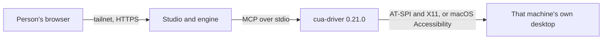
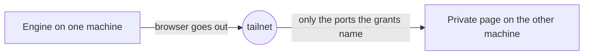
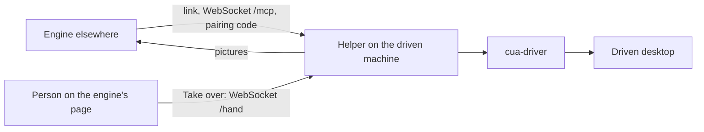
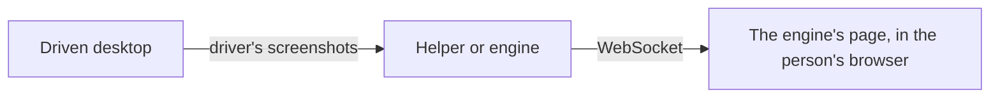

# The four arrangements between a Mac and Linux

Report of 2026-10-14. Each arrangement was run both ways between a Mac and a Linux team box over a
real tailnet, with Claude Opus 5.5 as the model. All eight passed when run again that evening, from
19:05 to 19:28 (India time). This report says how each one works, what was run, what it showed, and
what the model's use cost.

## Status

| # | Arrangement | Linux → Mac | Mac → Linux | Status |
|---|---|---|---|---|
| 1 | The engine on the system it drives (the micro VM, or a person's own OS) | The engine in the box's Linux desktop worked that desktop: the calculator showed 408 for 12 × 34, in 12 to 18 s, three runs | The ladder on the Mac's own screen: all five rungs and the stream passed | Passed |
| 2 | A remote engine reaches a person's data over Tailscale | The box's engine read a page served only on the Mac: "BLUE-HERON-42", 6 s | The Mac's engine read a page served only on the box: "RED-KESTREL-17", 8 s | Passed |
| 3 | A remote engine takes over a machine, which sends it pictures | The box's engine did a task on the Mac in 8 s; Take over from the box's page put the Mac's pointer at 0.40 for 0.4 | The Mac's engine opened the box's text editor and typed "hello from the Mac", 20 s; Take over put the box's pointer at 0.30 and 0.70 for 0.3 and 0.7 | Passed |
| 4 | The system streamed to the remote side | The Mac's screen, 1280 × 800, drawn in the box's page | The box's desktop, 1280 × 800, drawn in the Mac's page | Passed |

"Linux → Mac" means the engine is on the Linux box and the Mac is the far side. "Mac → Linux" is the
reverse.

## The machines

| | Mac | Team box |
|---|---|---|
| Name on the tailnet | `sharans-macbook-pro` (100.77.250.109) | `bap-browser-1` (the engine); `bap-desk-2` (the desktop) |
| System | macOS 26.6, Apple silicon (arm64) | Amazon Linux 2023, x86_64, 32 cores, 61 GB; no root |
| The desktop driven | The Mac's own screen | Ubuntu 24.04 in rootless Docker: Xvfb on `:1` at 1280 × 800, openbox |
| Tailscale | The Mac app | Userspace mode: socket `/tmp/tailscaled.sock`, proxy on `localhost:1055` |
| What runs there | A studio (`studio --dev`); the helper on 8796; a private page on 8800 | The engine's studio; the desktop's studio and its helper on 8796; a private page |

The tailnet is `tail4d0a18.ts.net`. The box's nodes join with the tag `tag:bap-vm`. The grants allow
`tag:bap-vm` to reach the Mac on tcp:8796 and tcp:8800 only, and members to reach `tag:bap-vm` on
tcp:443, 8796 and 8800. The box has no root and no KVM, so its "micro VM" is a container with a
desktop of its own, not a virtual machine with its own kernel.

## How each one works

### 1. The engine on the system it drives

The engine and the desktop are on one machine. `computer.runs` is `here`. The engine starts the
pinned driver, `cua-driver` 0.21.0, and gives the model Hermes' `computer_use` tool: capture, click,
type, keys, scroll, open an app and the rest. On Linux the driver reads the screen through AT-SPI
and X11. On macOS it uses Accessibility and Screen Recording. In the micro VM's form the engine
starts the machine's own virtual screen when none is given.

**Run on Linux.** From the Mac's browser, on the desktop's page: "Open the calculator and work out 12
times 34." The answers: "The calculator shows 408. I opened it (the app is called Galculator) and
typed 12 × 34 =." Three runs: 18 s, 18 s and 12 s. The page's line said "Engine on bap-desk-2 →
Works on the engine's own Linux desktop".

**Run on the Mac.** `scripts/ladder.py` on the Mac's own screen, with no model:

- Rung 1, the pinned driver is installed and answers: passed.
- Rung 2, a capture of TextEdit in each mode: som, 673 × 439 with 338 elements and a picture; vision,
  a picture; ax, 338 elements. Passed.
- Rung 3, a field is found by its number (element 1, AXTextArea), typed into, and the app holds the
  text. The typed text does not come back in the result. Passed.
- Rung 4, Stickies, which is not allowed, cannot be looked at: the driver refused it as "outside the
  capability manifest". Passed.
- Rung 5, while a person has taken over, the tool answers `human_has_control`, and works again after
  the hand back. Passed.
- The screen is streamed: 12 pictures of the whole screen, all 12 different. Passed.

### 2. A remote engine reaches a person's data over Tailscale

The engine's browser opens an address that exists only on the tailnet, published with
`tailscale serve`. On the box, Tailscale runs with no root, so the engine's browser goes out through
Tailscale's proxy on `localhost:1055` (`HTTP_PROXY`, `HTTPS_PROXY`). The grants decide which ports
the box may reach; port 8799 on the Mac was tried earlier and was blocked.

**Linux → Mac.** The box's Cloud browser was asked: "Open
https://sharans-macbook-pro.tail4d0a18.ts.net:8800/ and tell me the check word on it." It answered
"The check word is BLUE-HERON-42" in 6 s.

**Mac → Linux.** The Mac's engine opened the box's private page and answered "The check word is
RED-KESTREL-17. The page is titled 'Private data on the team box' and says it's only shown to the
tailnet" in 8 s.

### 3. A remote engine takes over a machine

`computer.runs` is `remote`. The engine runs a small link program as its driver. The link carries
the driver's MCP to the helper on the driven machine, over the tailnet, with a pairing code. The
helper checks who is calling: Tailscale's `whois` must name a login or tag the helper allows. At
the start the engine asks the helper which system it drives. The driver's program path says it
(`.app/Contents/` for macOS, `.exe` for Windows, anything else Linux). The engine names apps and
keys, and words the model's instructions, for that system rather than its own.

Take over sends a person's pointer and keys from the engine's page to the helper's `/hand`. The page
gives each place as a share of the picture. The helper turns it into a point on its own screen: with
macOS CGEvents on a Mac (`MacHand`), with `xdotool` on Linux (`X11Hand`). It measures against the
size it first told the page.

**Linux → Mac.** The box's engine, pointed at the Mac's helper, did a sample task on the Mac in 8 s
and listed the Mac's open windows. Take over from the box's page put the Mac's pointer at 0.40, 0.40
of its screen for 0.4 of the picture, read back from macOS. Only the pointer was moved on the Mac.

**Mac → Linux.** The Mac's engine, pointed at the desktop's helper, was asked: "Open the text editor
and write: hello from the Mac. Then tell me what the editor shows." It answered in 20 s: "I opened
the text editor, which is Mousepad on this computer, and typed the text. It now shows one line in a
new, unsaved document called 'Untitled 1': hello from the Mac." It also said the computer runs Linux,
not macOS. Run again just after the box's own engine had used the same desktop, it passed in 183 s.
Take over from the Mac's page put the box's pointer at 0.30 and 0.70 for 0.3 and 0.7, read back with
`xdotool`, twice.

### 4. The system streamed to the remote side

The engine sends the driven screen to every page that watches, and a new picture when it changes.
A page that is behind another tab says so, and the stream waits for it.

**Linux → Mac.** The Mac's screen, 1280 × 800, was drawn in the box's page; 1024 sampled points of
the picture were drawn.

**Mac → Linux.** The box's desktop, 1280 × 800, was drawn in the Mac's page, on every run.

## What was found, and fixed or noted

- **An engine on old code fails on Linux.** The first three runs of the Mac → Linux task that
  evening failed: the editor "never showed a window", then "no display it can capture". The trace
  showed the Mac's engine treating the box as a Mac. It had been restarted from a branch without the
  change that asks the helper which system it drives. Restarted on `main`, the same task passed in
  20 s.
- **The desktop's node name changes after a restart.** The desktop joins with an ephemeral key. After
  a restart it came back as `bap-desk-2`, and an engine pointed at `bap-desk-1` had to be given the
  new name. Not changed: keeping Tailscale's state would put key material on disk.
- **The desktop's records live in its container.** `deploy/box-desktop.sh` removes the container, and
  the records with it. Not changed yet.
- **A test that cannot run on Windows.** The helper's Tailscale test uses a shell script for
  `tailscale`, which Windows cannot start. It is now skipped there, as the driver's tests are.

## The tests

| What | Where | Result |
|---|---|---|
| The helper, the link, the hands, the deploy scripts, the computer tool, the secrets, the usage | 9 test files on the Mac: `test_machine_helper`, `test_a_hand_through_the_helper`, `test_remote_machine`, `test_x11_hand`, `test_mac_hand`, `test_deploy`, `test_secrets_stay_out`, `test_computer_use_tool`, `test_usage` | 131 passed |
| The line that says where a page works | `viewer/src/studio/where.test.ts` | 2 passed |
| The computer engine on each system | CI, `computer-on-each-system` on Ubuntu, macOS and Windows | Passed on all three |
| The real driver on Linux | CI on Ubuntu: the ladder on a virtual screen, through the helper, with any app, in the micro VM's form (no screen given), and in the contained desktop | Passed |
| The real driver on the Mac | `scripts/ladder.py` on the Mac | Every rung passed |
| The eight arrangements live | Scripts that drive the real pages from the Mac's browser | 8 of 8 passed |

## What the model's use came to

Each task keeps its model calls, tokens and cost. The backend adds the four systems up as each task
ends, into `.bap-browser/evals/usage.json`, and `bap-browser usage` prints it. Claude Opus 5.5 costs
$4 a million input tokens and $20 a million output tokens.

On the Mac:

| System | Tasks | Model calls | Input tokens | Output tokens | Cost |
|---|---:|---:|---:|---:|---:|
| Remote use (Cloud browser) | 11 | 69 | 506,672 | 4,116 | $0.2063 * |
| Browser use (My Chrome) | 0 | 0 | 0 | 0 | $0.0000 |
| Built-in browser | 0 | 0 | 0 | 0 | $0.0000 |
| Computer use | 31 | 206 | 1,566,377 | 17,369 | $2.7768 * |
| All four systems | 42 | 275 | 2,073,049 | 21,485 | $2.9830 * |

\* 29 older tasks ran on `gpt-5.6-luna`, which has no price here. They are counted in tokens but not
in cost. The 13 Claude tasks cost $2.98.

On the team box, Claude only:

| Where | System | Tasks | Model calls | Input tokens | Output tokens | Cost |
|---|---|---:|---:|---:|---:|---:|
| The engine | Remote use (Cloud browser) | 2 | 6 | 33,756 | 528 | $0.1456 |
| The engine | Computer use | 2 | 5 | 48,022 | 839 | $0.2089 |
| The desktop | Computer use | 4 | 23 | 238,174 | 2,290 | $0.9985 |

A computer task costs more than a browser task: each step sends a capture of the screen, so input
tokens are about 24 to 66 thousand a task against about 17 thousand for a page.

## What this does not show

- Linux was tested on X11 (Xvfb). Wayland was not.
- The Mac's own engine on the Mac was tested by the ladder, with no model, on this day; tasks with the
  model there were run earlier.
- On the Mac, Take over moved only the pointer: nothing was pressed or typed on the person's screen.
- Browser use (My Chrome) and the built-in browser recorded no tasks on these machines, so their
  usage rows are zero.
